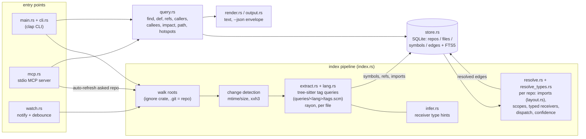

# codegraph guide

Walkthrough, every command and MCP tool, config, architecture, trade-offs, accuracy, performance and limitations. The [README](../README.md) is the short version.

## Try it in 60 seconds

From a clone, with Rust 1.85+ and a C compiler. The first `cargo build --release` is the slow
part (a few minutes cold); everything after it is instant. The throwaway `KIT_DATA_DIR` /
`KIT_CONFIG_DIR` keep it away from any real config (`.cache/` is gitignored).

```sh
cargo build --release
export KIT_DATA_DIR="$PWD/.cache/try/data" KIT_CONFIG_DIR="$PWD/.cache/try/config"
./target/release/codegraph index .
./target/release/codegraph callers store::Store::open --depth 1
./target/release/codegraph impact store::Store::open --depth 2
```

What that printed on this checkout (Windows 11, Git Bash):

```text
indexed 1 repos · 156 files (156 parsed, 0 unchanged, 0 removed) · 1,919 symbols · 21,795 edges (33% resolved) · 0.54s

store::Store::open (method)  ~/src/codegraph/src/store.rs:192
├─ accuracy::index_repo  bench/src/accuracy.rs:438
├─ scale::one_iteration  bench/src/scale.rs:263
├─ App::open_store  src/main.rs:64
├─ spawn_mcp_watcher  src/main.rs:405
├─ mcp::tests::server  src/mcp.rs:656
├─ store::tests::open_twice_and_version_reset  src/store.rs:601 ~ ×2
...
└─ concurrent_writer_waits_instead_of_failing  tests/watch.rs:196 ×2
20 node(s), depth 1; paths relative to each root's repo; ~ likely, ? name-only

impact of store::Store::open: 38 dependent symbol(s) in 11 file(s) within depth 2 (1 seed symbol(s))
```

(`33% resolved` counts every reference, including calls into std and dependencies,
which are deliberately left unresolved rather than guessed; `~` marks a `likely` edge.)

The same graph over MCP (stdio, one JSON-RPC message per line; the server exits 0 when stdin
closes or the client drops the pipe):

```sh
printf '%s\n' \
  '{"jsonrpc":"2.0","id":1,"method":"initialize","params":{"protocolVersion":"2025-06-18","capabilities":{},"clientInfo":{"name":"t","version":"0"}}}' \
  '{"jsonrpc":"2.0","method":"notifications/initialized"}' \
  '{"jsonrpc":"2.0","id":2,"method":"tools/list"}' \
  '{"jsonrpc":"2.0","id":3,"method":"tools/call","params":{"name":"codegraph_def","arguments":{"symbol":"store::Store::open"}}}' \
  | ./target/release/codegraph mcp
```

That returns the 8 read-only `codegraph_*` tools and the source of `Store::open`, one JSON
response per line and nothing else on stdout (logs go to stderr). To use it from Claude Code:
`claude mcp add codegraph -- codegraph mcp`.

## Quickstart

```powershell
codegraph index ~/dev          # index every repo under the configured roots
codegraph find Store           # search
codegraph def Store::open      # definition + doc comment
codegraph callers Store::open  # who calls it
codegraph impact Store::open   # what breaks if it changes
```

Real output, from indexing this repo (`codegraph index`, then a few queries):

```text
$ codegraph find Store --kind struct
# codegraph ~/src/codegraph
  struct  store::Store                   src/store.rs:177                           pub struct Store
  struct  a.Store                        tests/fixtures/go/a/a.go:5                 type Store struct
  struct  store.Store                    tests/fixtures/go_infer/store/store.go:16  type Store struct
  struct  store::Store                   tests/fixtures/rust/src/store.rs:5         pub struct Store
  struct  store.Cache (substring)        tests/fixtures/go_infer/store/store.go:27  type Cache struct
  struct  store::FileRow (substring)     src/store.rs:131                           pub struct FileRow
  ...
  struct  resolve::Pending (doc)         src/resolve.rs:1095                        pub struct Pending
```

```text
$ codegraph def store::Store::open
store::Store::open method ~/src/codegraph/src/store.rs:192-211
191|     /// Open (creating if needed) the database at `path`.
192|     pub fn open(path: &Path) -> Result<Self> {
193|         if let Some(dir) = path.parent() {
194|             std::fs::create_dir_all(dir)
195|                 .map_err(|e| Error::io(format!("create {}", dir.display()), e))?;
196|         }
197|         let conn = Connection::open(path)?;
198|         conn.busy_timeout(std::time::Duration::from_secs(10))?;
...
```

```text
$ codegraph callers store::Store::open --depth 1
store::Store::open (method)  ~/src/codegraph/src/store.rs:192
├─ accuracy::index_repo  bench/src/accuracy.rs:438
├─ scale::one_iteration  bench/src/scale.rs:263
├─ App::open_store  src/main.rs:64
├─ spawn_mcp_watcher  src/main.rs:405
├─ mcp::tests::server  src/mcp.rs:656
├─ store::tests::open_twice_and_version_reset  src/store.rs:601 ~ ×2
├─ index_dir  tests/common/mod.rs:36
├─ edit_touch_delete_and_full  tests/incremental.rs:61
...
└─ concurrent_writer_waits_instead_of_failing  tests/watch.rs:196 ×2
20 node(s), depth 1; paths relative to each root's repo; ~ likely, ? name-only
```

```text
$ codegraph impact store::Store::open --depth 2
impact of store::Store::open: 38 dependent symbol(s) in 11 file(s) within depth 2 (1 seed symbol(s))
depth 1 (direct)
  fn accuracy::index_repo  bench/src/accuracy.rs:438  via call
  fn scale::one_iteration  bench/src/scale.rs:263  via call
  method App::open_store  src/main.rs:64  via call
  ...
depth 2
  fn accuracy::score_repo  bench/src/accuracy.rs:455  via call
  fn scale::run  bench/src/scale.rs:433  via call
  fn run  src/main.rs:170  via call
  ...
files
     7  d1  ~/src/codegraph/src/mcp.rs
     7  d1  ~/src/codegraph/tests/incremental.rs
     6  d1  ~/src/codegraph/tests/watch.rs
  ...
```

(Generated at the commit that introduced this README, with a throwaway `KIT_DATA_DIR` /
`KIT_CONFIG_DIR`, never `~/.config/kit`; the repo root is shown as `~/src/codegraph` and line
numbers drift as the code changes.)

**Staying fresh:** `codegraph watch` re-indexes a repo about 300 ms after its files change (see
[watch](#watch)); `codegraph mcp --watch` does it in the background, and every MCP call also
refreshes the repo it asks about.

## MCP registration

```powershell
claude mcp add codegraph -- codegraph mcp
```

## Usage

```text
codegraph index [--full] [PATH...]      index the configured roots (default ~/dev), incrementally
codegraph find <name> [--kind fn] [--repo x]
codegraph def <symbol>                  definition + source (with its doc comment)
codegraph refs <symbol> [--kind call|ref|impl|inherit]
codegraph callers <fn> [--depth N]      call hierarchy up (tree), dispatch-aware
codegraph callees <fn> [--depth N]      call hierarchy down (tree; externals listed)
codegraph outline <file>                nested symbols with line ranges (-s for signatures)
codegraph path <from> <to>              shortest call path
codegraph impact <file|symbol> [-d N]   what transitively depends on this
codegraph hotspots [--repo x]           most referenced, largest fan-out, dead-code candidates
codegraph dot <symbol> [--format dot|mermaid]
codegraph watch [PATH...]               keep the graph fresh as files change (Ctrl-C stops)
codegraph status | config path|show | version | mcp [--watch]
```

A `<symbol>` can be a simple name (`Evaluate`), a qualified name (`rules.Engine.Evaluate`,
`store::Store::open`), or a location (`internal/engine/engine.go:294`, which picks the
innermost symbol enclosing that line). Global flags: `--json`, `-q/--quiet`, `-v/--verbose`,
`--no-color` (and `NO_COLOR`).

In trees, `~` marks a `likely` edge and `?` marks `name_only`. `[via Trait::method]` marks a
call resolved through dynamic dispatch (an interface/trait/base-class method, not the
concrete implementation shown). `[as value]` means the function is passed as a callback or
handler, not called. `[cycle]` and `[seen above]` mark recursion and repeated subtrees.

### `watch`

`codegraph watch [PATH...]` indexes the roots once, then re-indexes a repo ~300 ms after its
files change (`--debounce-ms`, max 2 s latency), with the same filters as `index`; build
output (`target/`, `node_modules/`, `.git/`...) never triggers work, new repos are picked up.
`--json` streams NDJSON (`ready`, `reindex`, `rescan`, `error`); Ctrl-C exits 0.
`codegraph mcp --watch` does the same in the background for repos already in the graph.

### `--json`

Every command prints exactly one `{"ok": true, "data": ...}` document, or
`{"ok": false, "error": {"code", "message"}}` with exit code 2 (usage), 3 (not found) or 1.
Symbols carry `id, name, kind, qname, repo, file (absolute), line, end_line, signature, doc`.

## MCP tools

| tool | answers |
|---|---|
| `codegraph_find` | search definitions by name (exact > qualified > prefix > substring > doc text > fuzzy) |
| `codegraph_def` | the definition's source, line-numbered, with its doc comment |
| `codegraph_refs` | every use site: calls, type refs, impls, inheritance, with the source line |
| `codegraph_callers` / `codegraph_callees` | call hierarchy trees with call sites, dispatch-aware |
| `codegraph_outline` | nested outline of one file (works on unindexed files too) |
| `codegraph_impact` | transitive dependents of a file or symbol, by distance, plus affected files |
| `codegraph_status` | repos, sizes, resolution rates, freshness |

`hotspots`, `dot` and `path` are CLI-only (not exposed over MCP). Each MCP result has
`structuredContent` (same shape as `--json` data) and a compact text rendering. The text
uses repo-relative paths under a `# repo root` header, so it stays token-efficient. All
tools are read-only.

**Auto-refresh:** before each call, the server re-indexes the relevant repo within
`refresh_budget_ms`. That is the repo named by `repo`, else the one containing a
`file`/`target` path, else the one containing the server's working directory. A repo is
refreshed at most once every 3 s. Only files whose mtime or size changed are re-hashed, and
only files whose content hash changed are re-parsed. This is what keeps the graph fresh
today; `codegraph watch` (above) will do the same for the CLI between MCP calls.

**Safety:** MCP never adds repos to the graph; only repos indexed with `codegraph index` are
refreshed. Path arguments are canonicalized and must resolve under a configured root. UNC
and device paths (`\\host\share`, `\\?\UNC\...`) are rejected lexically, before any
filesystem call. Unindexed files are outlined only inside an indexed repo, only when an
index pass would include them (not gitignored, hidden, in `skip_dirs` or a link), and
within `max_file_kb`.
Credential files (`.env*`, `*.pem`, `*.key`, `id_*`, `*.pfx`, `*.p12`, `*.kdbx`,
`credentials*.json`, `secrets.*`, `*.tfstate`, `.npmrc`, `.netrc`) are never indexed or
read. Source snippets have control characters replaced. Responses are capped at 256 KB with
lines clipped at 400 characters; large answers keep a short text summary next to
`structuredContent`.

## Config

`%USERPROFILE%\.config\kit\codegraph.toml` (or `$KIT_CONFIG_DIR\codegraph.toml`). The graph
lives in `<KIT_DATA_DIR or config dir>\codegraph\graph.db`. A missing file means defaults, and
unknown keys produce a warning.

```toml
roots = ["~/dev"]                 # every git repo below becomes a graph repo
skip_dirs = ["vendor", "node_modules", "target", "build", "dist", "out", ".git", ".venv",
             "venv", "__pycache__", ".next", ".cache", "third_party", "bower_components",
             "coverage", "testdata"]   # on top of .gitignore
max_file_kb = 1024                # skip bigger files (bundles, generated code); max 4194304
languages = ["go", "rust", "c", "cpp", "typescript", "tsx", "javascript", "python"]
color = "auto"                    # auto | always | never
refresh_budget_ms = 1500          # MCP auto-refresh budget per call (0 = off)
threads = 0                       # parser threads (0 = one per core; max 1024)
```

## Architecture



`bench/` (separate crate, `codegraph-bench`) clones the pinned corpus, builds SCIP ground
truth and scores the graph; `evals/agent/` runs the grep-vs-codegraph agent comparison.
Neither ships in the binary. [docs/PACKAGES.md](PACKAGES.md) says what every file does.

## Design decisions & trade-offs

- **Syntax-only, but measured.** No LSP, compiler or build step: tree-sitter tag queries
  ([queries/](../queries/)) plus a rule-based resolver, so one binary indexes Go, Rust, C/C++,
  TS/JS and Python in seconds. The cost is that it is a heuristic, so every resolver change is
  scored site by site against SCIP indexes on a pinned 16-repo corpus
  ([bench/src/accuracy.rs](../bench/src/accuracy.rs)), and a change that regresses any
  language is not kept.
- **A confidence on every edge instead of false certainty.** Edges are `exact` / `likely` /
  `name_only` ([src/model.rs:168](../src/model.rs#L168)), and the tiers are calibrated (table in
  [Accuracy](#accuracy)). A qualifier bound to an import outside the repo resolves to nothing
  rather than to a same-named symbol ([src/resolve.rs:8](../src/resolve.rs#L8)): lower
  recall on purpose, in exchange for edges an agent can trust.
- **Type hints without a type checker.** Per-file extraction (parallel, rayon) records a small
  hint for every receiver call (`x.foo()`): enclosing type, written type, constructor, field,
  element, `?`/`await` unwrap (grammar in [src/infer.rs](../src/infer.rs)'s module doc). A
  whole-repo pass evaluates them once every type is known
  ([src/resolve.rs:3039](../src/resolve.rs#L3039), `src/resolve_types.rs`). Parsing stays
  embarrassingly parallel and resolution lives in one place; the price is that what a
  compiler would infer through generics or closures can still fall back to name matching.
- **Incremental at two levels, SQLite as the only store.** mtime/size, then an xxh3 content
  hash, decide what to re-parse ([src/index.rs:509](../src/index.rs#L509),
  [src/index.rs:520](../src/index.rs#L520)); each repo is written in one transaction
  ([src/index.rs:558](../src/index.rs#L558)), and a run that dies before its resolve is
  repaired by the next one. The scale work traced cold-index cost to SQLite I/O, not
  parsing, and fixed it with bulk loads and deferred index builds; measured and rejected
  changes are both listed in [docs/SCALE.md](SCALE.md). `watch` keeps a big repo's
  resolver state in memory, verified edge-for-edge against a full re-resolve.
- **Small, read-only, hand-written MCP server.** No MCP SDK dependency; tools never write,
  UNC/device paths are rejected before any filesystem call and other paths must canonicalize
  under a configured root ([src/util.rs:83](../src/util.rs#L83)), and credential files are never
  indexed or read ([src/util.rs:175](../src/util.rs#L175)). Lints enforce the rest:
  `unsafe_code = "forbid"`, clippy `pedantic`, `unwrap`/`expect` denied outside tests
  ([Cargo.toml:73](../Cargo.toml#L73)); CI runs fmt, clippy and tests on Linux, Windows and
  (weekly) macOS.

## What I'd do next

- **Run the agent eval against a real model.** The harness and a capped real-model mode exist
  ([docs/AGENT-EVAL.md](AGENT-EVAL.md)), but the only recorded run uses a scripted fake
  LLM, so it measures token spend, not answer quality.
- **Hit the 100k-files-under-60-s cold-index goal.** Latest recorded runs are 91.8 s for Linux
  alone and 179.6 s for Linux + rust-lang/rust + Kubernetes; the next step is fewer rows and a
  smaller FTS index, or building FTS after the graph is queryable ([docs/SCALE.md](SCALE.md)).
- **Sub-second `watch` edits** by re-resolving only the affected edges instead of the whole
  repo in memory (3.5–3.7 s today on Linux).
- **Ground truth for C/C++**, which is extracted and resolved but not yet scored.
- **Publish the package channels.** v0.1.2 ships as release archives with install scripts;
  the scoop/winget/Homebrew/npm manifests in `packaging/` are written but not yet in a
  bucket, tap or registry ([docs/INSTALL.md](INSTALL.md)).

## How it works

1. **Walk**: the `ignore` crate walks each root (respecting `.gitignore` and `skip_dirs`).
   A file belongs to its nearest ancestor holding `.git`. `.h` is treated as C++ when its
   directory has C++ sources and no `.c` files. A root inside another root (`~/dev` and
   `~/dev/go`) is skipped with a warning: the outer walk already covers it, and every repo
   is named relative to its outermost root.
2. **Change detection**: a file is skipped when its mtime and size match the stored row,
   otherwise it is hashed with xxh3. An unchanged hash only updates the mtime. A changed
   `go.mod`, `Cargo.toml`, `package.json` or `tsconfig.json` re-indexes its whole repo,
   since every file's module path may have moved.
3. **Extract** (rayon, one parser per thread): the tag query captures definitions,
   references (calls, type uses, `impl Trait for T`, `extends`/`implements`, functions passed
   as values, and calls inside macro invocations like `assert_eq!(f(x))` or `vec![t(1)]`) and
   imports. Alongside each receiver-expression call, extraction records a **type hint**
   (`src/infer.rs`: the enclosing type, a written type, a constructor call, a field, a
   collection element, ...) so resolution isn't purely name-based. Code then computes
   nesting, containers (Go receivers, Rust `impl` types, C++ `A::b` scopes, classes), doc
   comments, signatures and exported-ness. Language builtins (`len`, `println!`, `print`,
   `string`) are dropped.
4. **Store**: each repo is written in one SQLite transaction (`repos`, `files`, `symbols`,
   `edges`, plus an FTS5 trigram index over names, qualified names and docs).
5. **Resolve**: every repo that changed is re-resolved as a whole, in memory. Import
   bindings are computed first:
   - Go: import paths map to package directories via `go.mod`.
   - Rust: crate and module paths come from the file layout and `mod`, and `use` trees are
     parsed, including `pub use` re-exports.
   - TS/JS: relative imports, `index` files, tsconfig `baseUrl`/`paths`, and monorepo
     workspace packages (`@scope/pkg` resolves to that package's own sources); default,
     named and namespace imports; `require`.
   - Python: absolute and relative module paths, `from x import y` of submodules.
   - C/C++: `#include` resolution plus header/source companions.

   Then each edge is resolved with ordered rules (`src/resolve.rs`): lexical scope and
   self/receiver calls first, then import-bound qualifiers, then **typed receivers**
   (`src/resolve_types.rs` evaluates the extraction-time hint against the whole repo — a
   type known in-repo, a type provably external, or unknown), then name-based fallback
   rules for what's left.
6. **Dispatch**: Go interfaces get implicit-satisfaction edges (method sets, including
   embedding and common stdlib interfaces, checked by arity — no explicit `implements`
   needed), and `callers`/`impact` follow interface/trait/base-class dispatch, annotating
   the call site `[via Interface::method]` when it's resolved through the abstract method
   rather than the concrete one shown.

## Accuracy

codegraph is a heuristic graph, not a type checker. [docs/ACCURACY.md](ACCURACY.md)
measures how right it is against **compiler-grade ground truth**: SCIP indexes built by
each language's own semantic indexer (scip-go, rust-analyzer, scip-typescript, scip-python)
on 16 real repos (10 public: go-chi/chi, urfave/cli, labstack/echo, sharkdp/fd, tokio-rs/bytes,
serde-rs/json, sindresorhus/ky, mobx, zustand, pallets/click; 6 of the author's own tools),
scored site by site.

| language | files | defs found | callers recall | false call edges | refs recall | refs precision | impl recall / precision |
|---|---:|---:|---:|---:|---:|---:|---:|
| Go | 364 | 100% | 100.0% | 0.2% | 99.8% | 99.9% | 100% / 94.4% |
| Python | 124 | 100% | 100.0% | 0.4% | 99.1% | 99.7% | 100% / 99.0% |
| TypeScript/JS | 396 | 100% | 99.2% | 0.5% | 98.2% | 99.7% | 100% / 100% |
| Rust | 195 | 100% | 98.5% | 1.3% | 98.8% | 99.3% | – |
| **all** | 1079 | 100% | 99.5% | 0.6% | 99.2% | 99.7% | 100% / 96.3% |

The same harness scores the v0.1.1 resolver at 77.0% callers recall with 13.8% false call
edges. Where it still falls short, honestly: Rust extension traits on std types (`impl
BufMut for &mut [u8]`), impls on reference types and receivers typed only through closures
(serde-json 98.3%, bytes 97.8% callers recall), object-literal properties typed by a call's
parameter (`defineTool({ run, summarize })`), Rust attribute arguments
(`#[arg(value_parser = f)]`), and impl pairs no ground truth
can decide (generic Go interfaces; see [docs/ACCURACY.md](ACCURACY.md), which also has
per-repo numbers). Go and Python implementations are also checked against the language
itself (go/types, the runtime MRO), not only the SCIP indexers.

Confidence calibration (share of judged edges that are actually correct):

| language | exact | likely | name_only |
|---|---:|---:|---:|
| Go | 100.0% | 85.2% | 76.1% |
| Python | 99.9% | 99.6% | 77.8% |
| TypeScript/JS | 99.8% | 100.0% | 95.7% |
| Rust | 99.6% | 95.8% | 46.7% |
| **all** | 99.9% (47,193 / 47,258) | 97.5% | 87.9% |

Rust has no `impl`/`inherit` score: rust-analyzer's SCIP output emits no implementation
relationships to compare against.

Reproduce with:

```powershell
task bench:accuracy
```

(This clones the pinned corpus and builds four SCIP indexers into `.cache/bench/` on first
run — expect it to take a while and to need network access; the private repos in the corpus
are skipped on machines that don't have them.)

## Agent eval

[docs/AGENT-EVAL.md](AGENT-EVAL.md) runs the same 31 code questions (Go/Rust/TS/Python;
callers, callees, impact, definitions, implementations, semantic) through the same agent
loop twice — once with grep-only tools, once with the codegraph MCP tools — and measures
token spend. **Read the numbers honestly:**

| arm | pass rate | tokens total (messages) | tokens / question (median) | tokens incl. tool schemas (est.) |
|---|---|---:|---:|---:|
| grep | 31/31 (100%) | 46,521 | 1,430 | 94,481 |
| codegraph | 31/31 (100%) | 25,408 | 708 | 127,315 |

- **This run used a scripted fake LLM, not a real model.** The 100%/100% pass rate proves
  the harness and grading work, not that a real agent is equally correct on both arms — the
  fake cannot get anything wrong. A real-model run is written but not yet executed (needs
  `ANTHROPIC_API_KEY`; see the doc for the estimate-then-run commands and a proxy-enforced
  $5 cap).
- **Content tokens favor codegraph, 0.55× of grep's**, on these scripted, well-aimed tool
  paths. But the codegraph arm carries 10 tool schemas resent on every turn (~1.5k tokens: the
  8 `codegraph_*` tools plus grep and read_file) against grep's 3 (~545), so **including schema overhead the codegraph arm's raw
  total is 1.35× grep's** for this question set — prompt caching would offset most of
  that in practice, but it isn't measured here.
- Tokens reflect real tool output sizes along realistic tool-call paths (the proxy actually
  executes every call against the real `codegraph mcp` server and the corpus); they do not
  reflect how many turns, or wrong turns, a real model would take.

Reproduce with:

```powershell
task eval:agent
```

## Performance

Full index of `~/dev` (3,117 files in 42 repos, ~394k edges): **4.7 s** on a release build,
Windows 11, 16 cores (7.0 s for 2,634 files on v0.1.1). Kernel-sized repos (Linux, rust-lang/
rust, Kubernetes: cold index, no-op and one-file re-index, the resident resolver of `watch`)
are measured in [docs/SCALE.md](SCALE.md).

## Limitations

This is a **heuristic graph, not a type checker**. The numbers above are the actual measured
error rates — read them before trusting an edge blindly, especially `likely` and
`name_only` ones.

- **No general type checker.** Typed-receiver resolution (`src/infer.rs` +
  `src/resolve_types.rs`) covers the common patterns — locals, fields, constructors,
  parameters, loop/callback elements, `?`/`.unwrap()`/`await` unwrapping — but it is still
  a heuristic walking syntax, not a compiler. When it has no opinion, resolution falls back
  to name-based rules, which is where `name_only` and most wrong `likely` edges come from
  (calibration table above).
- **Interface/trait/base-class dispatch** points `callers`/`impact` at all known
  implementations via `[via ...]` annotations, but a resolved call still targets one
  concrete symbol (or the abstract method) per edge, not a fan-out to every implementer.
- **Rust is the weakest language: 98.5% callers recall on the corpus** (99% on the author's
  own Rust tools, ~98% on generic- and macro-heavy libraries like serde-json and bytes).
  Extension traits on std types, impls on reference types, receivers typed only through
  closures and `#[cfg]` twins across modules are the main misses. False call
  edges stay low (1.3%).
- **`#[cfg]` / build-tag twins**: codegraph picks one variant of a `#[cfg]`-gated or
  build-tag-gated definition; SCIP (and the compiler) pick the host's. This shows up as
  scoring noise on gated code, not as a systematic blind spot.
- **Macro-generated code**: a Rust `macro_rules!` macro is expanded where the file that
  defines it invokes it (what it defines and the calls in the tokens handed to it land at
  the invocation), but macros from other files (`#[macro_use]`, `$crate::m!`), procedural
  macros, and decorators or generators that synthesize code are invisible beyond what
  tree-sitter sees in the source.
- **C/C++ are not in the accuracy benchmark.** They're extracted and resolved with the same
  engine and rules as everything else (imports via `#include`, header/source companions),
  but no SCIP-equivalent ground truth was scored for them — treat their confidence tiers
  with extra caution.
- **Reflection, dynamic `import()`, decorators that rewrite dispatch, and calls through
  function-typed fields** are invisible unless the receiver/qualifier is resolvable by the
  rules above. Functions passed as values are captured only when qualified (`s.handle`) or
  defined/imported in the same file.
- **Cross-repo edges are not linked**: a qualifier bound to an import outside the repo
  (stdlib, a dependency, another indexed repo) resolves to nothing, by design, instead of
  guessing a same-named symbol elsewhere.
- **Rust module paths come from file layout** (`src/a/b.rs` is `a::b`) plus file-level
  `#[path = ".."] mod x;` declarations; `include!` is ignored.
- **`hotspots` orphans are candidates, not verdicts**: entry points, callbacks registered
  indirectly, and exported API are excluded or invisible, so review before deleting
  anything.
- A handful of scoring artifacts remain even in the numbers above (e.g. 2 of the Go `impl`
  "false" pairs in the corpus are real cross-package implementations that scip-go itself
  doesn't record) — see [docs/ACCURACY.md](ACCURACY.md) for the method and per-language results.

- **Reproducing the benchmarks needs more than this repo.** 6 of the 16 accuracy-corpus
  repos are the author's private tools (skipped on other machines, so a fresh run scores
  only the 10 public repos), and the agent eval drives `evalrig`, a separate harness that is
  not part of this repo. The agent eval has only been run against a scripted fake LLM (see
  [Agent eval](#agent-eval)); there is no real-model result yet.

See also [docs/COMPARISON.md](COMPARISON.md) for how this stacks up against grep, ctags,
LSP servers, SCIP/Sourcegraph and GitHub code search.

## Development

```powershell
cargo fmt --check ; cargo clippy --all-targets -- -D warnings ; cargo test
task snapshots        # re-record fixture snapshots, then review the diff
task bench:accuracy   # resolver accuracy vs SCIP ground truth, delta vs baseline
task eval:agent       # grep vs codegraph token/pass-rate comparison (fake LLM)
task release          # dist/codegraph-<ver>-windows-amd64.zip
```

Tests:
- `tests/fixtures/<lang>/` mini-projects are snapshotted with `insta` and asserted for the
  classic resolution traps: the same name in two packages, a method vs a function, Go
  receivers and implicit interfaces, Rust `impl` blocks and traits, TS default vs named
  exports and path aliases, and Python relative imports and inheritance.
- `tests/fixtures/{go,rust,ts}_infer/` cover typed-receiver resolution specifically
  (`tests/resolve.rs`).
- Incremental re-indexing: an edit re-parses one file; a delete drops its symbols with no
  dangling edges.
- Graph algorithms (depth, cycles, path, impact) on a known graph.
- CLI envelopes and exit codes.
- An MCP stdio session that indexes a never-seen repo on demand.
- A self-index test that finds `main`.
- `bench/` (accuracy vs SCIP) and `evals/agent/` (agent token/pass-rate eval) are their own
  harnesses with their own test suites; see docs/ACCURACY.md and docs/AGENT-EVAL.md.
